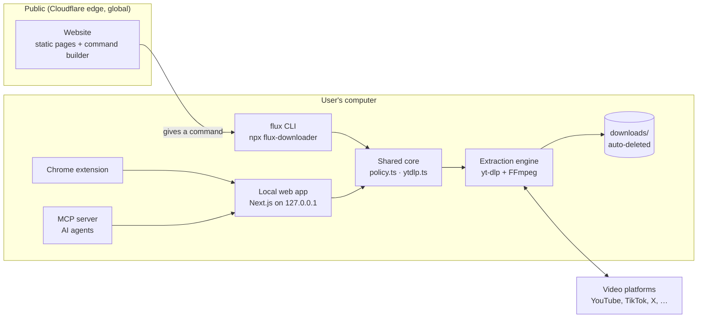
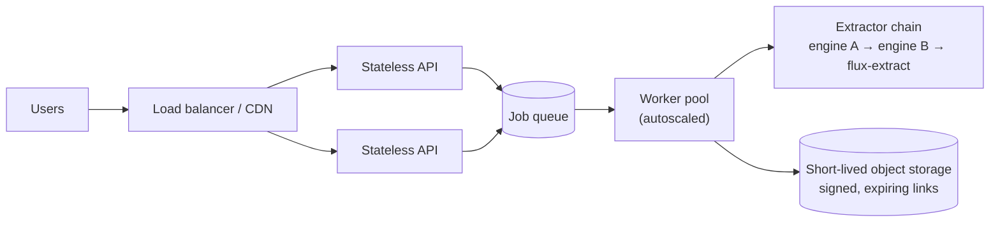

# Flux architecture

Flux has one idea at its core: **the video is downloaded on the user's own computer, never through a server we run.** That keeps hosting cheap, scales with every new user for free, and keeps Flux out of the business of storing or redistributing other people's media.

## Overview

| Part                         | Where it runs                                                       | Code                                               |
| ---------------------------- | ------------------------------------------------------------------- | -------------------------------------------------- |
| **Public website**           | Cloudflare Workers (static assets, served from the edge worldwide)  | `src/app`, `wrangler.jsonc`, `open-next.config.ts` |
| **`flux` CLI**               | User's computer (`npx flux-downloader`)                             | `src/cli`, `packages/cli`                          |
| **Local web app + REST API** | User's computer, bound to loopback                                  | `src/app/api`, `src/lib/engine.ts`                 |
| **Chrome extension**         | User's browser, sends the tab URL to the local app                  | `extension/`                                       |
| **MCP server**               | User's computer, lets AI agents call the local app                  | `mcp/server.ts`                                    |
| **Shared core**              | Imported by the CLI and the web app so both enforce identical rules | `src/lib/policy.ts`, `src/lib/ytdlp.ts`            |
| **Engine**                   | yt-dlp and FFmpeg installed on the user's machine                   | external                                           |

## Request flows

**Local download (web app).** Browser → `POST /api/inspect` → `guard()` (loopback host and origin only) → `validateUrl()` (https, known platform, no credentials, no adult terms) → yt-dlp metadata → `enforceContentPolicy()` (no live, playlist, age-restricted or sexual metadata) → qualities shown. `POST /api/downloads` queues a job (max 2 at once) that yt-dlp writes into a random-UUID folder; the file is streamed back with `Content-Disposition: attachment`.

**CLI.** Same `validateUrl`, `enforceContentPolicy` and yt-dlp flags, then yt-dlp writes straight into the folder the user chose.

**Public website.** The page is prerendered. The "Get download command" button runs entirely in the browser: it checks the platform list and prints an `npx flux-downloader "<url>"` command. No request about the video ever reaches our server.

## Trust boundaries

1. **Internet → public website:** static content only; the API routes exist in the Worker bundle but `guard()` refuses everything that is not loopback.
2. **Browser → local app:** loopback host plus same-origin (or the Chrome extension origin) is required, which also blocks DNS-rebinding and cross-site requests.
3. **Local app → yt-dlp:** no shell, `--ignore-config`, `--` before every URL, and an import path that ignores the current folder (a planted `yt_dlp.py` cannot run).
4. **Platforms → Flux:** all metadata (titles, descriptions) is untrusted text; it is filtered and shown as text, never executed or rendered as HTML. MCP clients are told the same.

## Scaling, load and redundancy

**The public site does not need a load balancer.** Cloudflare serves it from the data centre nearest each visitor, so traffic spikes are absorbed by the edge. It is already redundant across many locations.

**Downloads scale with users, not with us.** Because each user's own computer and network do the work, 10 or 10 million users cost the same: nothing. This is the main reason for the design.

**If we ever host downloading ourselves** (not planned, see the legal notes) the design would be:

Stateless API behind a load balancer, a queue so bursts wait instead of failing, an autoscaled worker pool, per-IP rate limits and abuse controls, expiring storage, and more than one extraction engine so one broken extractor does not take the service down.

## Extraction engines (roadmap)

Today there is **one** engine, yt-dlp, which is also the biggest single point of failure: when a platform changes, that platform breaks until yt-dlp updates. The plan, tracked in the GitHub issues:

1. Put a small `Extractor` interface in front of yt-dlp (`inspect(url)` and `download(url, quality)`).
2. Add a second, independent engine as a fallback, selected per platform.
3. Build Flux's own extractor package, starting with the platforms that already work without sign-in, so Flux does not depend on any single project.

## Data and retention

- Job records and files live in `downloads/` on the user's computer. Finished jobs older than `FLUX_RETENTION_DAYS` (default 7) are deleted automatically; `0` keeps everything.
- Nothing is sent to analytics. The website sets no cookies of its own; Google AdSense, if enabled, is disclosed in the privacy and cookie pages.

## Known failure modes

| What breaks                            | Effect                                            | Mitigation                                                      |
| -------------------------------------- | ------------------------------------------------- | --------------------------------------------------------------- |
| A platform changes its site            | That platform fails until yt-dlp updates          | `flux doctor`, update guide, second engine (planned)            |
| Platform needs sign-in (Reddit, Vimeo) | Clear "could not be accessed" message             | Not supported on purpose; no passwords or cookies are collected |
| yt-dlp or FFmpeg missing               | Setup instructions shown in the CLI and the app   | `flux doctor`                                                   |
| Disk fills up                          | Downloads fail                                    | 4 GB per-file cap, automatic retention cleanup                  |
| Cloudflare outage                      | Website unreachable; local app and CLI unaffected | Edge redundancy; nothing local depends on the website           |
