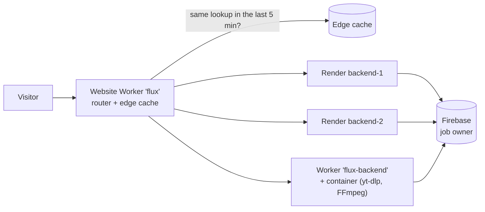

# Flux backend on Cloudflare: deploy, keys, cache and load balancing

This adds a third download backend that runs on Cloudflare itself, next to your two Render backends. You never manage a container: Cloudflare runs it behind a normal Worker called `flux-backend`.



## Requirements

- Cloudflare **Workers Paid** plan (about $5 a month). Containers are only available on it, and usage beyond the included amount is billed.
- Docker Desktop running on the computer you deploy from (Wrangler builds the image locally, then uploads it).
- Wrangler signed in to your account: `npx wrangler login`.

## 1. Deploy the backend

```powershell
npm run cf:backend:dry-run   # builds the image and checks the config, uploads nothing
npm run cf:backend:deploy    # uploads the image and publishes the Worker
```

The backend appears at `https://flux-backend.<your-workers-subdomain>.workers.dev` (for you: `https://flux-backend.detroonshah.workers.dev`). Until you add the secrets below, it refuses every request with "not configured", so it is safe to leave in that state.

## 2. Keys: what to add where

Use the **same** three shared values everywhere (the same ones your Render backends already use).

| Value                           | What it is                                                                  | Where it comes from                                                                                                                                    |
| ------------------------------- | --------------------------------------------------------------------------- | ------------------------------------------------------------------------------------------------------------------------------------------------------ |
| `FLUX_ROUTER_SECRET`            | Shared password between the website and every backend                       | The one you already set on Render and the website. If you start fresh: `node -e "console.log(require('node:crypto').randomBytes(32).toString('hex'))"` |
| `FIREBASE_DATABASE_URL`         | Address of the Realtime Database that records which backend owns a download | Firebase console, Realtime Database                                                                                                                    |
| `FIREBASE_SERVICE_ACCOUNT_JSON` | Private key file as one line                                                | Firebase, Project settings, Service accounts                                                                                                           |

**On the new backend Worker** (run each in your terminal; Wrangler asks you to paste the value, so it never goes in a file or in chat):

```powershell
npx wrangler secret put FLUX_ROUTER_SECRET --config wrangler.backend.jsonc
npx wrangler secret put FIREBASE_DATABASE_URL --config wrangler.backend.jsonc
npx wrangler secret put FIREBASE_SERVICE_ACCOUNT_JSON --config wrangler.backend.jsonc
npx wrangler secret put TURNSTILE_SECRET_KEY --config wrangler.backend.jsonc   # only if you use Turnstile
```

New secrets reach the container the next time it starts (it stops after 15 idle minutes, or redeploy).

**On the website Worker `flux`** add the new backend to `FLUX_BACKENDS`. It currently lists `backend-1` and `backend-2` (see `wrangler.jsonc`). Add the third:

```json
{
  "backend-1": "https://flux-qxb8.onrender.com",
  "backend-2": "https://flux-l5qr.onrender.com",
  "cf-1": "https://flux-backend.detroonshah.workers.dev"
}
```

Then redeploy the website (push to `_prod`, or `npm run cf:deploy`).

**On GitHub** (Settings, Secrets and variables, Actions), for the website's automatic deploys:

| Kind     | Name                             | Value                                            |
| -------- | -------------------------------- | ------------------------------------------------ |
| Secret   | `CLOUDFLARE_API_TOKEN`           | Cloudflare token with permission to edit Workers |
| Secret   | `CLOUDFLARE_ACCOUNT_ID`          | Your Cloudflare account ID                       |
| Variable | `FLUX_ROUTER`                    | `true`                                           |
| Variable | `FLUX_PUBLIC_URL`                | The website's address (`https://flexdow.xyz`)    |
| Variable | `SEO_INDEXABLE`                  | `false` until your own domain is live            |
| Variable | `NEXT_PUBLIC_TURNSTILE_SITE_KEY` | Only if you use Turnstile                        |

Never put these values in a file in the repository. The full list of settings, with notes, is in [.env.example](../.env.example).

## 3. When you buy your own domain

1. Add the domain to Cloudflare (or buy it through Cloudflare Registrar) so its DNS is on Cloudflare.
2. Attach it to the website Worker by adding to `wrangler.jsonc`, then redeploy:

   ```jsonc
   "routes": [
     { "pattern": "your-domain.com", "custom_domain": true },
     { "pattern": "www.your-domain.com", "custom_domain": true }
   ]
   ```

3. Set `SITE_URL` in `wrangler.jsonc` and the GitHub variable `FLUX_PUBLIC_URL` to `https://your-domain.com`, and change `SEO_INDEXABLE` to `true`.
4. In Cloudflare, SSL/TLS, turn on **Always Use HTTPS**.
5. In Turnstile, add the new hostname to the widget.
6. Optional: give the backend a tidy address the same way (`api.your-domain.com`, `custom_domain: true` in `wrangler.backend.jsonc`) and update `cf-1` in `FLUX_BACKENDS`. It works fine on `workers.dev` too.
7. Submit `https://your-domain.com/sitemap.xml` to Google Search Console.

Nothing else changes: the router, the cache and the secrets stay the same.

## Load balancing

The website Worker is the load balancer. For every new lookup or download it:

1. asks each backend how busy it is (a quick health check),
2. tries the least busy one first,
3. moves on to the next one if a backend is blocked by the platform or full,
4. sends every later request for that download to the backend that owns it (recorded in Firebase).

A backend can be marked `{"url": "...", "fallback": true}` to be tried only after the others. Cloudflare's paid "Load Balancing" product is not needed for this.

## Cache

The website Worker keeps a cache at Cloudflare's edge in front of the backends:

- **What:** the result of a video lookup (title, creator, qualities), keyed by a hash of the link. Nothing about visitors is stored.
- **How long:** 5 minutes for a good answer, 1 minute for "no backend could fetch it". Busy or error answers are never cached.
- **Effect:** the same link looked up again is answered by the website Worker without waking a backend. Unsupported links are also refused there, before any backend is contacted.
- **Check it:** look up the same link twice; the second response has the header `X-Flux-Cache: HIT` (the first says `MISS`).
- **Clear it:** entries expire on their own after the time above; there is nothing to purge.

Downloaded video files are never cached, because they are private to the visitor and large.

## Costs and limits

- Workers Paid is about $5 a month. The container is billed for the time it runs (vCPU, memory, disk) and for traffic beyond the included amount. It sleeps after 15 idle minutes, so an unused backend costs little.
- `wrangler.backend.jsonc` uses the `basic` size (1/4 vCPU, 1 GiB memory, 4 GB disk) and up to 2 instances. Change `instance_type` to `standard-1` for more memory.
- The first request after sleeping takes longer while the container starts. The router's health check waits 5 seconds, so a sleeping backend may be skipped once; the next request finds it awake.
- Files live on the container's temporary disk and disappear when it restarts or sleeps. Visitors who return later are asked to download again.
- Platforms that block data-centre addresses may also block Cloudflare's. This has not been tested from Cloudflare's network. See [PLATFORM-BLOCKS.md](PLATFORM-BLOCKS.md).
