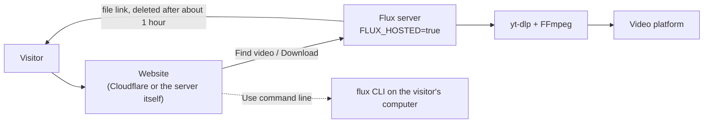

# Hosted download server

For a ready-to-configure Render Blueprint, private Firebase job directory, and
website routing across backends, follow [Firebase and Render setup](FIREBASE-RENDER.md).

Flux normally downloads on the user's own computer. **Hosted mode** adds a second option: a download box on the website that fetches the video through a Flux server. The command-line option stays next to it, so visitors can choose.

Read this first, because hosting downloads is a different business from hosting a website:

|                  | Website only (today)    | With a download server                                                                               |
| ---------------- | ----------------------- | ---------------------------------------------------------------------------------------------------- |
| Cost             | Free on Cloudflare      | A server that runs all the time (about $5–15 a month for a small one) plus bandwidth for every video |
| Files            | Never touch your server | Pass through your server for a short time                                                            |
| Abuse            | Almost none             | Real: bots, bulk scraping, takedown requests                                                         |
| Legal and ads    | Lower risk              | Higher risk. Google AdSense and platform terms are stricter on sites that download for visitors      |
| Speed under load | Cloudflare handles it   | You need limits (built in) and, if it grows, more servers                                            |

## How it works



The box offers **Find video** (server download) and **Use command line** (copy a ready-to-run command). Every safeguard from the local app applies on the server too: only known platforms, no sign-in, no age-restricted or sexual content, no live streams or playlists.

## Run it

Everything runs in one Docker image with Node, Python, yt-dlp and FFmpeg (tested locally):

```powershell
docker build -t flux-server .
docker run -p 3000:3000 flux-server
```

Open http://localhost:3000. The image serves the website and the API from the same address, so no cross-site setup is needed.

### Option A: the server is the whole site (simplest)

Point your domain at the container (through Cloudflare for HTTPS, caching and DDoS protection). Build with your public address:

```powershell
docker build -t flux-server --build-arg SITE_URL=https://your-domain --build-arg SEO_INDEXABLE=true .
```

### Option B: keep the Cloudflare website, add the server as the API

1. Deploy the container at an address such as `https://api.your-domain`, with `FLUX_ALLOWED_ORIGINS=https://your-domain` so only your website may call it from a browser.
2. Rebuild and deploy the Cloudflare site with `NEXT_PUBLIC_FLUX_API=https://api.your-domain` (and `FLUX_PUBLIC_SITE=true`). The page then shows the download box. The security policy automatically allows the website to contact that one address.

Without `NEXT_PUBLIC_FLUX_API`, the Cloudflare site keeps showing only the command-line option.

## Settings

| Variable                         | Default in the image | Meaning                                                                                                 |
| -------------------------------- | -------------------- | ------------------------------------------------------------------------------------------------------- |
| `FLUX_HOSTED`                    | `true`               | Turns on hosted mode (public host allowed, per-visitor limits, no list of other people's downloads)     |
| `FLUX_ALLOWED_ORIGINS`           | empty                | Comma-separated websites allowed to call the API from a browser                                         |
| `FLUX_MAX_HEIGHT`                | `1080`               | Highest resolution offered on the server. Visitors needing more are pointed to the CLI                  |
| `FLUX_MAX_FILESIZE`              | `1G`                 | Largest file a download may produce                                                                     |
| `FLUX_MAX_DURATION`              | `1800`               | Longest video in seconds                                                                                |
| `FLUX_MAX_CONCURRENT`            | `3`                  | Downloads running at once on this server                                                                |
| `FLUX_RATE_INSPECT`              | `30`                 | Lookups per visitor per 10 minutes (`0` turns the limit off)                                            |
| `FLUX_RATE_DOWNLOAD`             | `8`                  | Downloads per visitor per hour (`0` turns the limit off)                                                |
| `FLUX_RETENTION_HOURS`           | `1`                  | Finished files are deleted after this many hours                                                        |
| `TURNSTILE_SECRET_KEY`           | empty                | Turns on the Turnstile bot check on the server. A runtime secret: never put it in the image or the repo |
| `NEXT_PUBLIC_TURNSTILE_SITE_KEY` | empty                | Public Turnstile site key the website uses to show the check. Set at build time                         |

The visitor address comes from `cf-connecting-ip`, `fly-client-ip` or `x-forwarded-for`, so run the server behind Cloudflare or another proxy that sets one of them. Without a proxy, every visitor shares one limit bucket.

## Bot protection (Cloudflare Turnstile)

Turnstile is Cloudflare's free CAPTCHA alternative. It is invisible for most people and only asks for a click when a visit looks automated. When it is on, every lookup and every download needs a fresh one-time token, and the server checks it with Cloudflare before doing any work. If Cloudflare cannot be reached, requests are refused rather than let through.

1. In the Cloudflare dashboard open **Turnstile → Add widget**, add your website's domain, and choose "Managed". You get a **site key** (public) and a **secret key** (private).
2. Build the website (or the Docker image) with the site key: `--build-arg NEXT_PUBLIC_TURNSTILE_SITE_KEY=<site key>` for Docker, or the same variable in the Cloudflare site build.
3. Run the server with the secret: `docker run -e TURNSTILE_SECRET_KEY=<secret key> ...`.

Both keys must be set. With only the secret, visitors cannot get a token and every request is refused. With only the site key, the check is simply not enforced. Cloudflare publishes test keys for trying it out: the site key `1x00000000000000000000AA` with the secret `1x0000000000000000000000000000000AA` always passes, and the secret `2x0000000000000000000000000000000AA` always fails. The check was tested end to end with these.

## Before you turn it on for real

- [ ] Use a server with enough bandwidth and disk. One 1080p video is about 50–250 MB. A hosting plan with capped transfer can get expensive fast.
- [ ] Put Cloudflare in front, with "Always use HTTPS", and turn on the Turnstile bot check (next section).
- [ ] Read the privacy and terms pages. They now describe the download box, and a lawyer should review them. See [LEGAL.md](../LEGAL.md) and issue #6.
- [ ] Read Google AdSense's policies on downloader sites before you put ads on a site that downloads for visitors.
- [ ] Monitor disk use, errors and the number of downloads, and be ready to switch the box off by redeploying without `NEXT_PUBLIC_FLUX_API`.

## Limits of this design

- Rate limits live in each server's memory. With more than one server they are not shared. Use one server, or add a shared store such as Redis, before scaling out (see [ARCHITECTURE.md](ARCHITECTURE.md) and issue #3).
- The job list is kept per browser. Clearing browser storage forgets recent downloads, though files still expire on their own.
- Platforms that need a sign-in (Reddit, Vimeo) still cannot be downloaded, here or anywhere in Flux.
